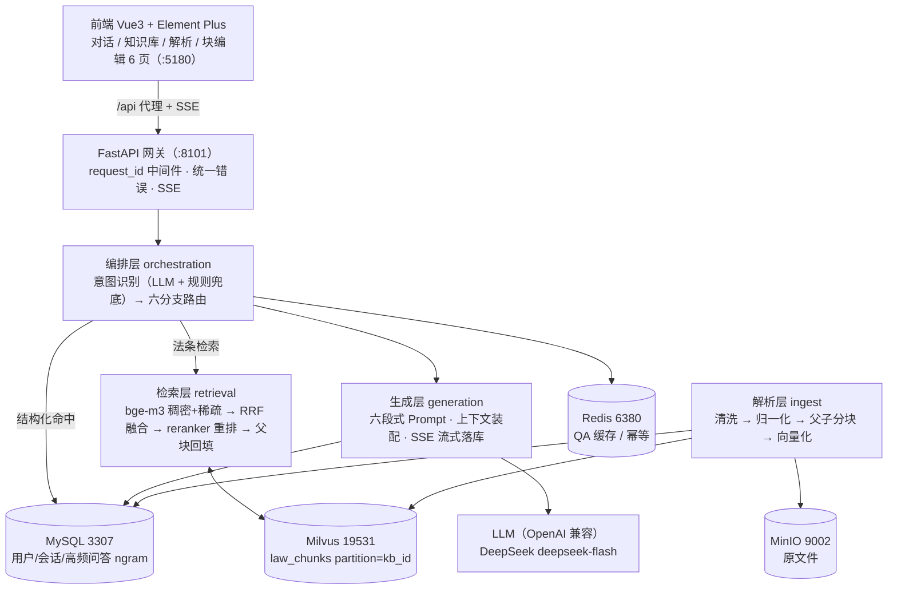
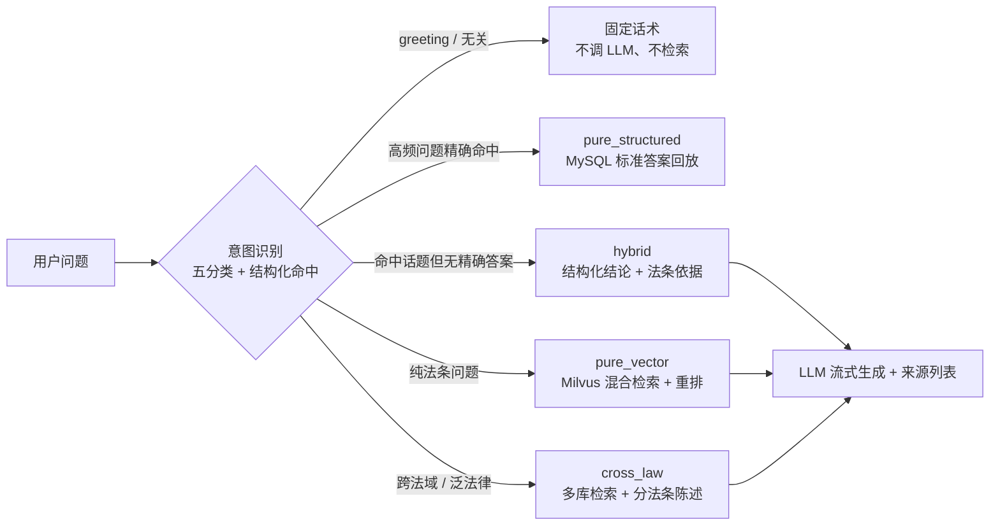

# LawAnswer

面向中国法律条文的 **多路 RAG 问答系统**：把《劳动合同法》《劳动法》《民法典》按"编→章→节→条→款"结构化切块，用 bge-m3 的稠密 + 稀疏双向量存入 Milvus，配合 MySQL 高频问答对与 Redis 热缓存做双源路由，经 RRF 融合与 bge-reranker-v2-m3 重排后，由可切换的大模型（默认 DeepSeek `deepseek-flash`）**流式**生成带法条引用的回答。

> 当前进度：**8 个阶段全部完成** —— 解析入库、混合检索、意图路由、流式生成、前端 6 页、评估闭环已验收；
> 阶段 8 交付物已就位：`scripts/bootstrap.ps1`（一键跑通，实测 65.5s）、`scripts/demo.py`（10 问覆盖 6 路由，10/10 通过）、
> 简历项目描述见 [`docs/简历项目描述.md`](./docs/简历项目描述.md)。
> 完整设计见 [`LawAnswer 项目总体设计方案.md`](./LawAnswer%20项目总体设计方案.md)，评估数据见 [`REPORT.md`](./REPORT.md)。

## 技术栈

| 层 | 选型 |
|---|---|
| 语言/包管理 | Python 3.13 + uv |
| Web | FastAPI + Uvicorn（SSE 流式） |
| 存储 | MySQL 8（用户/会话/高频问答）、Milvus 2.4（向量）、Redis 7（缓存）、MinIO（原文件，可选） |
| Embedding | bge-m3（稠密 1024 + 稀疏） |
| Rerank | bge-reranker-v2-m3 |
| LLM | 可切换（OpenAI 兼容）：DeepSeek `deepseek-flash`（默认）/ 通义千问 `qwen-max`（DashScope） |
| 评估 | ragas 0.3.0（独立依赖组） |
| 前端 | Vue 3.5 + Vite 7 + TypeScript + Pinia + Vue Router + Element Plus |

## 架构总览



**双源路由**：一次问答先看"是不是高频问题"（MySQL + 向量双门判定），再看"要不要查法条"（Milvus），
两者可以叠加也可以各自单走，因此有 6 条分支：



## 5 分钟一键跑通（推荐）

```powershell
# 前置：Docker Desktop 已启动、uv 已安装、密钥已写入用户环境变量
setx DEEPSEEK_API_KEY sk-xxxx        # 新开终端生效

cd E:\project\LawAnswer
.\scripts\bootstrap.ps1
```

一条命令串行完成 10 步，全程幂等、失败即停并给出下一步建议：

| 步骤 | 动作 | 幂等性 |
|---|---|---|
| 1 | 检查 docker / uv / 密钥 / `.env` | — |
| 2 | `docker compose up -d` 并等 5 个服务端口就绪 | 已运行则跳过 |
| 3 | `uv sync`（GPU 版 torch 自动加 `--no-install-package torch` 保护） | 已同步则 0.5s |
| 4 | 建 MySQL 表 + 种子数据 | 重复执行安全 |
| 5 | 建 Milvus collection `law_chunks` | 已存在则跳过 |
| 6 | 下载 bge-m3 / reranker（约 4.4GB） | 已完整则跳过 |
| 7 | 启动后端并轮询健康 | 端口占用则复用 |
| 8 | 创建 `kb_labor` / `kb_civil` | 已存在则跳过 |
| 9 | 入库三部法律（内容未变则 SHA1 跳过） | 已入库则 0.1s |
| 10 | 跑 `scripts/demo.py` 冒烟（10 问覆盖 6 路由） | — |

常用开关：

```powershell
.\scripts\bootstrap.ps1 -SkipModels        # 模型已手工放好
.\scripts\bootstrap.ps1 -SkipIngest        # 只起服务，不入库
.\scripts\bootstrap.ps1 -SkipSync -SkipModels -SkipIngest   # 最快路径
.\scripts\bootstrap.ps1 -Reset             # 重建 Milvus collection（清空向量）
```

实测：依赖与数据齐备时 **65.5s** 走完 10 步，冒烟演示 **10/10 通过**。

## 手动分步（想逐步排查时用）

```bash
# 1. 安装依赖
uv sync

# 2. 配置（.env 只放非敏感项；密钥放系统环境变量）
cp .env.example .env
# 密钥三选一（设置后重开终端生效）。.env 默认指向 DeepSeek：
#   DEEPSEEK_API_KEY   （配合 .env 里 api.deepseek.com + deepseek-flash + 关闭思考模式）
#   DASHSCOPE_API_KEY  （配阿里云百炼时，把 .env 的 LLM_BASE_URL / LLM_DEFAULT_MODEL 一起改）
#   LLM_API_KEY        （通用写法，优先级最高）
# 自检：确认 base_url / 模型 / 密钥三者对得上，并探测普通对话、流式、JSON 三项能力
uv run python -m scripts.check_llm

# 3. 启动基础设施（镜像本地已有，无需联网拉取）
docker compose up -d
docker compose ps                        # 三个 healthy 才算就绪

# 4. 建库建表 + 建 Milvus collection
uv run python -m app.db.init_db
uv run python -m scripts.init_milvus

# 5. 下载本地模型（约 4.4 GB，镜像优先）
uv run python -m scripts.download_models --check
uv run python -m scripts.download_models

# 6. 入库三部法律（首次约 10 分钟，CPU 向量化）
uv run python -m app.ingest.pipeline --dry-run --all   # 先看条数：98 / 107 / 1260
uv run python -m app.ingest.pipeline --all

# 7. 启动后端
uv run python -m app.server
# http://127.0.0.1:8101/docs
curl http://127.0.0.1:8101/api/health

# 8. 启动前端（另开终端）
cd frontend && npm install && npm run dev
# http://localhost:5180  （/api 已代理到 8101）
```

## 端口规划（全部偏移，避开本机其他项目）

| 服务 | 端口 | 说明 |
|---|---|---|
| MySQL | 3307 | 与本机旧 mysql_container（3306）隔离 |
| Redis | 6380 | db 3 |
| Milvus | 19531 / 9092 | 19530/9091 已被 shopmate 占用 |
| MinIO | 9002 / 9003 | 9000/9001 已被占用 |
| FastAPI | 8101 | 8000/8100 在本机被系统保留，无法绑定 |
| Vue Dev | 5180 | 5173 被占用 |

## GPU 加速（可选）

PyPI 上的 torch 是 CPU 构建（`torch.cuda.is_available()=False`），向量化与重排都会跑在 CPU 上。
要用上显卡，装对应 CUDA 版本后把 `EMBEDDING_DEVICE` 改成 `cuda` 即可（代码会自动检测并回退）：

```bash
uv pip install --index-url https://download.pytorch.org/whl/cu126 "torch==2.9.1+cu126"
# .env: EMBEDDING_DEVICE=cuda
```

## 检索调试

```bash
curl -X POST http://127.0.0.1:8101/api/retrieval/preview \
  -H "Content-Type: application/json" \
  -d '{"question":"试用期最长可以约定多久","complexity":"simple"}'
```

返回每条候选的 `score`（RRF 融合分）与 `rerank_score`，可直接对比重排前后排序变化。

## 意图与路由调试

```bash
curl -X POST http://127.0.0.1:8101/api/intent/preview \
  -H "Content-Type: application/json" \
  -d '{"query":"试用期最长可以约定多久？","kb_ids":["kb_labor"]}'
```

返回意图（五分类）、改写类型、复杂度、路由决策（含 `use_mysql_qa` / `use_milvus` 与理由）、
问答库判定（精确命中/同类参考）。未配置任何大模型密钥时自动走规则兜底（`degraded=true`），
链路不断；配置后同一接口即切换 LLM 路径。

## 大模型 provider（可换厂商）

底层走 **OpenAI 兼容协议**，换厂商只改 `.env` 两行 + 换密钥环境变量名，代码不用动：

| 厂商 | LLM_BASE_URL | LLM_DEFAULT_MODEL | 密钥环境变量 |
|---|---|---|---|
| DeepSeek（当前默认） | `https://api.deepseek.com` | `deepseek-flash`（或 `deepseek-v4-pro`） | `DEEPSEEK_API_KEY` |
| 阿里云百炼 | `https://dashscope.aliyuncs.com/compatible-mode/v1` | `qwen-max` | `DASHSCOPE_API_KEY` |
| 任意兼容服务 | 服务商地址 | 服务商模型名 | `LLM_API_KEY`（优先级最高） |

DeepSeek 需额外设 `LLM_THINKING=disabled`：官方**默认开启思考模式**，而思考模式下
`temperature` 无效、默认输出上限从 8K 变 64K、延迟与费用都明显上升；RAG 问答与意图识别都用非思考模式。
DashScope / OpenAI 没有这个参数，留空即可（不会发送）。

密钥按 `LLM_API_KEY` → `DEEPSEEK_API_KEY` → `DASHSCOPE_API_KEY` 顺序取第一个非空值；
**只从系统环境变量读**，写进 `.env` 会被启动自检拒绝（`config.assert_secrets_not_in_dotenv`）。

```bash
uv run python -m scripts.check_llm      # 打印 base_url/模型/密钥来源 + 三项能力探测
curl http://127.0.0.1:8101/api/health   # 含 llm_key_configured / llm_key_source / llm_base_url / llm_model
```

**唯一例外**：图片 OCR 固定用 DashScope 的 `qwen-vl-ocr`，只认 `DASHSCOPE_API_KEY`
（DeepSeek 无视觉接口）。没有这个 key 时上传图片会明确报错，不影响 PDF/PPTX/Markdown。

## 前端（阶段 6）

```bash
cd frontend
npm install
npm run dev      # http://localhost:5180，/api 代理到 8101
npm run build    # vue-tsc 类型检查 + 产物构建
node e2e/walkthrough.mjs   # 浏览器走查（需前后端都已启动），截图写入 docs/screenshots/
```

6 个页面：`/login`、`/register`、`/chat`（三栏 + 知识库 chip + 参数抽屉）、`/kb`、`/kb/:kbId/parse`、`/kb/:kbId/doc/:docId`。
接口约定由 `tests/test_frontend_contract.py` 锁定（字段名/类型/状态码），后端改字段会直接让测试变红。

**鉴权**：JWT（HS256，24h）+ bcrypt(cost=12) + 4 位 SVG 验证码（Redis，120s，一次性）。
登录失败 5 次锁 60s；账号不存在与密码错误返回同一句文案。会话与问答接口强制登录，
知识库接口暂未挂鉴权（见阶段 6 验收记录遗留）。

## 流式问答调试（SSE）

```bash
curl -N -X POST http://127.0.0.1:8101/api/chat/stream \
  -H "Content-Type: application/json" \
  -d '{"query":"试用期最长可以约定多久？","kb_ids":["kb_labor"]}'
```

事件序列：`meta → stage(intent/retrieval/rerank/generate) → sources → delta×N → done`，
异常时发 `error{code, message, retriable}` 后仍以 `done` 收尾。三种典型行为：

- **纯结构化**（高频问题精确命中）：不回放检索、不调 LLM，直接分片推送标准答案（`done.cached=true` 表示来自 Redis 精确缓存）；
- **纯法条/混合/跨法**：真实检索 → 来源列表 → 大模型流式生成，回答带 `（《中华人民共和国劳动合同法》第十九条）` 式引用；
- **无资料**：引导话术（"暂未在所选知识库中找到……"），**不编造法条**。

历史对话传 `history: [{role, content}]`（自动按 5 轮 / 2000 token 预算裁剪）；
落库传 `session_id`（**需要登录**，且会话归属当前用户）。

## API 文档

交互式文档：`http://127.0.0.1:8101/docs`（Swagger）/ `/redoc`。下表是全量端点清单。

### 元信息与会话

| 方法 | 路径 | 说明 |
|---|---|---|
| GET | `/api/health` | 依赖健康检查（MySQL/Redis/Milvus 状态 + 延迟 + 是否配置 LLM 密钥） |
| GET | `/api/health/live` | 存活探针（不探测依赖），压测与 bootstrap 用它做就绪判定 |
| POST | `/api/auth/captcha` | 获取图形验证码（Base64 图片 + captcha_id） |
| GET | `/api/auth/check-username` | 注册页实时查重 |
| POST | `/api/auth/register` | 注册（201） |
| POST | `/api/auth/login` | 登录，返回 JWT |
| GET | `/api/auth/me` | 当前登录用户（需 Bearer Token） |
| GET | `/api/sessions` | 会话列表（按最近活跃排序） |
| POST | `/api/sessions` | 新建会话（201） |
| PATCH | `/api/sessions/{id}` | 重命名 / 改参数 |
| DELETE | `/api/sessions/{id}` | 删除会话（软删） |
| GET | `/api/sessions/{id}/messages` | 消息历史（升序） |

### 知识库与文档

| 方法 | 路径 | 说明 |
|---|---|---|
| GET | `/api/kbs` | 知识库列表（含文档数 / 块数） |
| POST | `/api/kbs` | 新建知识库（201，id 规则 `^[a-z0-9_]+$`） |
| GET | `/api/kbs/{kb_id}/documents` | 文档列表（含状态 / 进度 / 条数 / SHA1） |
| POST | `/api/kbs/{kb_id}/documents` | 上传并异步解析（202，返回 doc_id + job） |
| GET | `/api/documents/{doc_id}` | 文档详情（含解析进度与错误） |
| DELETE | `/api/documents/{doc_id}` | 删除文档（含向量） |
| POST | `/api/documents/{doc_id}/reingest` | 重新解析（202，源文件缺失则报错） |
| GET | `/api/documents/{doc_id}/chunks` | 块列表（分页 + 关键词 + 类型过滤） |
| PATCH | `/api/chunks/{chunk_id}` | 编辑块（触发该块重新向量化） |
| DELETE | `/api/chunks/{chunk_id}` | 删除块（软删 + 删向量） |
| POST | `/api/ingest/local` | 把 `data/raw` 下文件直接入库（同步，调试用；参数 `kb_id` / `filename` / `chunk_size` / `overlap` / `force`） |

### 问答与调试

| 方法 | 路径 | 说明 |
|---|---|---|
| POST | `/api/chat/stream` | **正式问答**，SSE 流式（详见下节） |
| POST | `/api/intent/preview` | 意图识别与路由预览：返回 intent / route / qa / sub_queries / degraded |
| POST | `/api/retrieval/preview` | 检索预览：返回每条命中的融合分、重排分、父块内容 |

`/api/chat/stream` 事件协议（`text/event-stream`）：

```
event: stage    data: {"stage": "intent"|"retrieval"|"rerank"|"generate"}
event: meta     data: {"message_id","intent","route","rewrite_type","complexity","cached","degraded"}
event: sources  data: {"sources":[{"law_name","article_no","chapter_path","score","snippet","kind"}]}
event: delta    data: {"text": "..."}          # 逐段输出，前端拼成打字机
event: done     data: {"ttft_ms","latency_ms","token_usage","sources_count","cached"}
event: error    data: {"code","message","retriable"}
```

调用示例：

```bash
curl -N http://127.0.0.1:8101/api/chat/stream \
  -H "Content-Type: application/json" \
  -d '{"query":"试用期最长可以约定多久？","kb_ids":["kb_labor"]}'
```

## 常见问题

| 现象 | 原因 | 处理 |
|---|---|---|
| `WinError 10013` 启动失败 | 端口被 Windows 保留/占用 | 改 `SERVER_PORT`（本机 8100 不可用，已用 8101） |
| `uv sync` 把 GPU 版 torch 换回 CPU 版 | `pyproject.toml` 里 torch 声明为 CPU 版，与手工装的 `2.14.1+cu130` 不一致 | 用 `uv sync --no-install-package torch`，后续 `uv run` 加 `--no-sync`；`bootstrap.ps1` 已自动处理。重装 GPU 版：`uv pip install E:\temp_torch\torch-2.14.1+cu130-cp313-cp313-win_amd64.whl` |
| 下载模型报 `401 Unauthorized ... cas-server.xethub.hf.co` | huggingface_hub 2.x 默认走 Xet，镜像站不代理 | 脚本已设 `HF_HUB_DISABLE_XET=1`，无需手工处理 |
| 下载模型报 `ProxyError: 502` | 本机代理（如已设 `HTTPS_PROXY`）抖动 | `--retries 3` 重试，或临时 `set HTTPS_PROXY=` 走直连 |
| `uv run python -m ...` 报模块找不到 | 需在项目根目录执行，`python -m` 才会把根目录加入 sys.path | `cd E:/project/LawAnswer` 后再执行 |
| 回答报"生成服务未配置 API Key" | 密钥没设或终端没重开 | `uv run python -m scripts.check_llm` 查看密钥来源与 base_url 是否匹配 |
| 报 401 / model not found | `LLM_BASE_URL` 与 `LLM_DEFAULT_MODEL` 不属于同一厂商 | 按 provider 表成套改（DeepSeek：`https://api.deepseek.com` + `deepseek-flash`） |
| 上传图片报"需要视觉模型" | DeepSeek 无视觉接口 | 另配 `DASHSCOPE_API_KEY`，或把图片转成 Markdown/PDF 再上传 |

## 安全约定

- **大模型密钥只从系统环境变量读取**（`LLM_API_KEY` → `DEEPSEEK_API_KEY` → `DASHSCOPE_API_KEY` 取第一个非空），
  不写入 `.env`、代码或仓库。
- 启动时执行自检：若 `.env` 中出现密钥赋值行，应用**拒绝启动**（`config.assert_secrets_not_in_dotenv`）。
- 日志与健康检查只输出"是否已配置"，不输出密钥内容。

## 测试

```bash
uv run python -m pytest tests/ -v          # 全离线，不加载模型、不连数据库
```

需要真实依赖的用例标记为 `integration`，默认跳过：

```bash
RUN_INTEGRATION=1 uv run python -m pytest tests/ -v -m integration
```

## 评估（阶段 7）

完整报告见 [`REPORT.md`](./REPORT.md)，验收记录见 [`docs/验收记录-阶段7.md`](./docs/验收记录-阶段7.md)。

```bash
# 样本校验（40 条，含"期望法条是否真实存在于语料"）
uv run python -m app.eval.qa_dataset

# 意图识别：acc / macro-F1 / 混淆矩阵 → eval/results/intent.json
uv run python -m app.eval.intent_eval
uv run python -m app.eval.intent_eval --rules-only   # 规则兜底基线

# 检索消融 L1/L2/L3/L4 → eval/results/recall.json；固定窗口 D 组 → recall_window.json
uv run python -m app.eval.recall_eval
uv run python -m app.eval.window_eval

# 端到端 + RAGAS（先起服务）：先采集回答，再打分（可续跑）
uv run python -m app.server
uv run python -m app.eval.ragas_eval --collect
uv run python -m app.eval.ragas_eval

# 压测：四档并发，120 次请求
uv run python -m app.eval.loadtest --levels 1 5 10 20
```

```bash
# 交付演示：10 个典型问题覆盖 6 条路由（需后端在跑）
uv run python -m scripts.demo
uv run python -m scripts.demo -v --json eval/results/demo.json
```

当前结果（本机 RTX 4060 Laptop / CUDA 13.0 + `deepseek-flash`，即 `REPORT.md` 最终配置）：

| 项 | 实测 | 目标 |
|---|---|---|
| 意图 acc / macro-F1 | **1.0000 / 1.0000** | ≥0.90 / ≥0.88 ✅ |
| 检索 Recall@5（L6 法域过滤后） | 0.7071（单跳 15/15 = 1.000） | ≥0.85 ❌ |
| 检索 MRR | 0.6886 | ≥0.75 ❌ |
| 法条截断率 | **0.00%** | ≤3% ✅ |
| RAGAS faithfulness | 0.7075（收紧 Prompt 前 0.5189） | ≥0.85 ❌ |
| 无答案不编造 | 5/5 | 是 ✅ |
| 压测 QPS（并发 10 / 20） | **1.994 / 2.686**（CPU 时 0.289 / 0.303） | ≥3 ❌ |
| 压测错误率 | **0.00%**（240/240） | ≤1% ✅ |

未达标项的根因与改法见 `REPORT.md` §8.2：检索是"多跳未走子查询分解"（加权 RRF 已证伪、法域过滤部分有效）；
忠实度剩余缺口来自计算示例代入值与免责句（Prompt 收紧已 +18.9pt）；性能瓶颈已从检索转为两次 LLM 调用。

## 目录结构

```
app/
├── main.py            FastAPI 装配（中间件/异常/路由/生命周期）
├── server.py          开发服务器入口（接管 uvicorn 日志）
├── core/              config 之外的公共设施：logger / middleware / errors / sse
├── db/                mysql / redis / milvus 客户端、schema、init_db
├── api/               health / auth / sessions / chat（SSE）/ intent / retrieval / kbs
├── ingest/            阶段 2：解析→清洗→父子分块→向量化
├── retrieval/         阶段 3：混合检索 + RRF + 重排 + 动态 topK
├── orchestration/     阶段 4：意图识别 + 改写 + 路由
├── generation/        阶段 5：Prompt + SSE + 历史 + 落库
└── eval/              阶段 7：Recall / 意图 / RAGAS / 压测

frontend/              阶段 6：Vue3 6 页（views / components / stores / api / e2e）
eval/                  阶段 7：qa_test_cases.jsonl（40 条样本）+ datasets/ + results/（评估产物）
config.py              唯一配置源（pydantic-settings）
mysql/init/            建表 + 知识库种子数据
scripts/               模型下载、Milvus 初始化、bootstrap.ps1（一键跑通）、demo.py（交付演示）
tests/                 单元测试（离线）
REPORT.md              阶段 7 评估报告（环境/语料/消融/意图/RAGAS/压测/结论）
```

## 开发阶段

| 阶段 | 内容 | 状态 |
|---|---|---|
| 1 | 基础设施 | ✅ 完成（已验收） |
| 2 | 解析与入库 | ✅ 完成（已验收） |
| 3 | 检索层 | ✅ 完成（已验收） |
| 4 | 意图识别与路由 | ✅ 完成（已验收；20 条真实样本 **acc/macro-F1 = 1.0000/1.0000**，规则基线 0.60） |
| 5 | 生成链路 | ✅ 完成（已验收；真实 `deepseek-flash` 流式生成 + 法条引用核对通过） |
| 6 | 前端 6 页 | ✅ 完成（已验收；走查截图见 `docs/screenshots/`） |
| 7 | 测试与评估 | ✅ 完成（已验收；四件套脚本 + 40 条 QA + 五组消融 + RAGAS + 压测，结果见 `REPORT.md`；3 类指标未达标，根因与改法已写明） |
| 8 | 交付与演示 | ✅ 完成（一键 bootstrap 65.5s 走通 10 步；demo 10 问覆盖 6 路由 10/10 通过；README 架构图 + API 文档 + 简历 STAR） |
